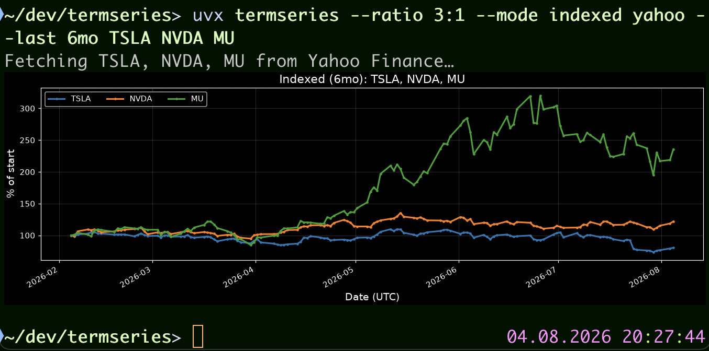

# termseries

[](https://github.com/deeplook/termseries/actions/workflows/ci.yml)
[](https://pypi.org/project/termseries/)
[](https://pypi.org/project/termseries/)
[](https://pepy.tech/project/termseries)
[](https://github.com/deeplook/termseries/blob/main/LICENSE)
[](https://www.buymeacoffee.com/deeplook)

Render time series in your terminal or as interactive browser charts. Plot Yahoo
Finance prices, Polymarket histories, Home Assistant sensors, Obsidian daily-note
fields, or local CSV data.

**[Documentation](https://deeplook.github.io/termseries/)** ·
[Examples](https://deeplook.github.io/termseries/examples/) ·
[Python and embedding](https://deeplook.github.io/termseries/browser/) ·
[Changelog](CHANGELOG.md)



## Install

```sh
pip install termseries
# Optional browser charts:
pip install 'termseries[browser]'
```

Or use uv: `uv tool install termseries`. Python 3.10 or newer is required.

## Quick start

```sh
# Terminal plot or PNG fallback:
termseries yahoo TSLA AAPL

# Compare daily closing prices, rebased to 100:
termseries --mode indexed yahoo --last 1y TSLA NVDA

# CSV data, fitted to its actual time span:
termseries csv readings.csv --last auto --unit °C

# Interactive terminal UI:
termseries -i yahoo TSLA NVDA

# Standalone, offline browser chart:
termseries --backend plotly --mode indexed --ratio 16:9 --theme light \
  --output stocks.html --open yahoo --last 1y TSLA NVDA
```

Global options go before the source command; source-specific options go after it.
Use `termseries --help` or `termseries SOURCE --help` for the CLI reference.

## What it supports

- Five sources: Yahoo Finance, Polymarket, Home Assistant, Obsidian and CSV.
- Absolute, indexed, log, drawdown, returns, relative, cumulative, delta and seasonal charts.
- Missing-interval line breaks, step styles, timezone display and flexible time ranges.
- Inline terminal graphics, PNG files and a Textual UI with reload controls.
- Optional interactive HTML, embeddable fragments and direct Python rendering.

## Documentation

The detailed guides live in [`docs/`](docs/index.md) and are published on
[GitHub Pages](https://deeplook.github.io/termseries/):

| Topic | Guide |
| --- | --- |
| Installation and first chart | [Quick start](docs/getting-started.md) |
| CLI options and time ranges | [CLI](docs/cli.md) · [Time ranges](docs/time-ranges.md) |
| Data sources and formats | [Yahoo](docs/sources/yahoo.md) · [Polymarket](docs/sources/polymarket.md) · [CSV](docs/sources/csv.md) · [Home Assistant](docs/sources/hass.md) · [Obsidian](docs/sources/obsidian.md) |
| Modes, gaps and overlays | [Chart modes](docs/modes.md) · [Seasonal](docs/seasonal.md) |
| Browser charts and Python | [API and embedding](docs/browser.md) · [Renderer gallery](docs/gallery.md) |
| Appearance and output | [Configuration](docs/configuration.md) · [Styles](docs/styles.md) · [Output](docs/output.md) |
| Development and docs preview | [Development](docs/development.md) |

## Contributing

See [CONTRIBUTING.md](CONTRIBUTING.md). To preview or build the documentation:

```sh
uv sync --extra docs
uv run --extra docs mkdocs serve
uv run --extra docs mkdocs build --strict
```

## License

[MIT](LICENSE)
